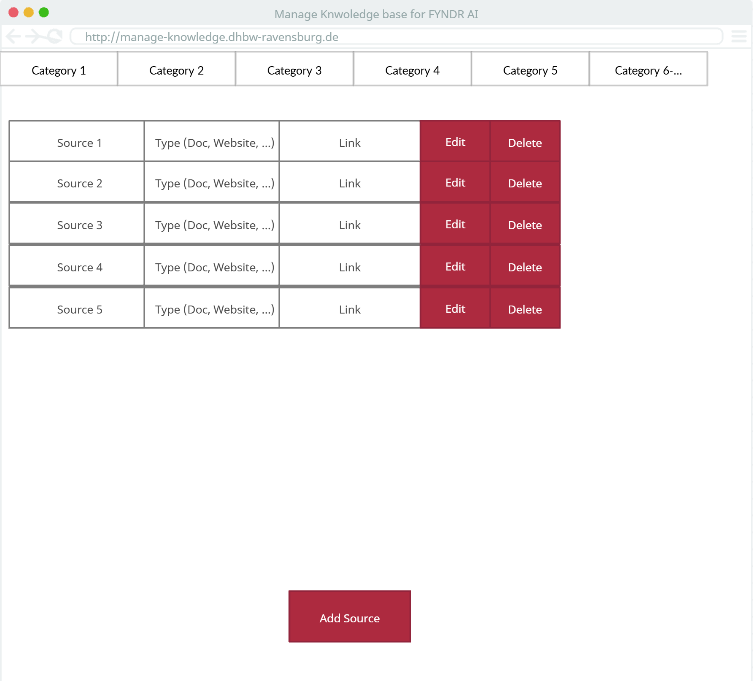
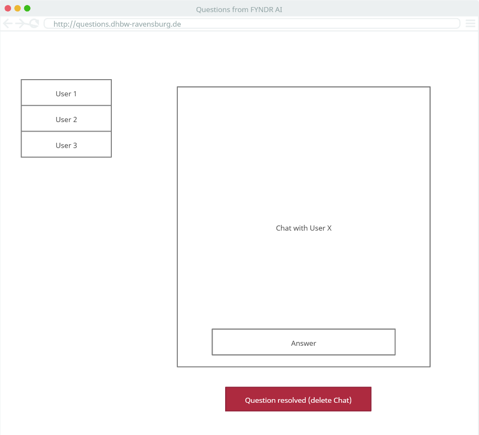

# Open questions

## Name
Is the name FYNDR AI or CampusConnect AI (Figure 1 caption)?

## Usage (TBD-02)
Must students log in with a university account, or is use anonymous? (Sections 2.3 and 2.7)

**Current state in SRS:** the chatbot can be used without login. A login is only needed to see the conversation history and to forward questions to staff (A-07, FR-AUTH-001, FR-AUTH-003).

## History
If anonymous, how is history linked to a person (device, session)?
If there is no history, should escalated questions get redirected to a different website with only a chat and cookies to store the chat?

**Current state in SRS:** only logged-in users have a history. Their conversations are stored in their account and are available on every device (EXT-UI-009, FR-CHAT-003, FR-HIST-002). What happens to the conversation of a user without login is not defined yet (see "Conversations").

## Supported languages (TBD-03)
Which languages are supported besides German and English? (NFR-QA-002)

## Language selection (TBD-08)
Is the language chosen only manually, or detected automatically (via cookies, written text, or a selection)?
If manual, at the start with a popup menu (hello, what language?)?

**Current state in SRS:** still open. Section 4.4 currently assumes manual selection at any time, with the browser language preselected (English if it is not supported). For logged-in users, the choice is saved in the account. Answers are always in the selected language (FR-LANG-001 to FR-LANG-005).

## Information conflict
How should conflicting information in different sources be handled?

**Current state in SRS:** university documents take precedence over external websites (FR-ANS-011). Still open: contradictions between two university documents.

## Outside information
How should out-of-scope questions (tutoring, personal advice, other stuff than university information) be handled?

**Current state in SRS:** the chatbot replies that it cannot help with the topic and names the topics it can answer (FR-ANS-010). Whether such questions can be forwarded to staff is not defined.

## Hardware & running costs (TBD-04)
On which hardware should the model run? Cloud based bot or local DHBW hardware? Who pays the running costs? (Sections 2.4, 2.5 and 2.7)

## Model (TBD-04)
Which model should be used as a base for the chatbot? (Sections 2.4, 2.5 and 2.7)

## Encryption
How is the chat protected against hackers? (TLS?)

## Feedback (TBD-09)
What feedback can students give? Good/Bad or text? What information is included?

**Current state in SRS:** still open. FR-FB-001 only states that users can rate each answer.

## Notifications
Should the user get notified when an escalated question got answered by staff?
Should the staff get notified when a question escalates?
What kind of notification should that be?

**Current state in SRS:** logged-in users get an e-mail when staff replied, without the content of the reply (FR-ESC-007), and see an indicator on the chatbot button (FR-ESC-006). Staff are not notified and check the list of escalated questions themselves (Section 4.8).

## UI
Are the mockups for the knowledge management and escalated questions ok?

## Where (TBD-07)
Where should the bot be embedded: on the DHBW homepage, in Moodle, or both? (Section 2.1)

**Current state in SRS:** still open. Section 4.2 assumes pages of the university website (FR-CHAT-001).

## DHBW locations (TBD-06)
Does FYNDR AI cover DHBW Ravensburg only or further DHBW locations? (Section 2.3)

## Users
Who may use the chatbot? The SRS now allows everyone to use it without login, including external users such as prospective students (Section 2.3). Is that intended, or should it be limited to members of the university?

**Current state in SRS:** everyone, without login (FR-AUTH-001).

## Login provider
Which identity provider do users log in with to see their history and to forward questions: the university account or an external provider (e.g. Google or Microsoft)? External users and exchange students before their arrival have no university account yet.

**Current state in SRS:** still open (part of TBD-02). Section 4.1 mentions an external identity provider for users; staff and knowledge administrators log in with the university identity provider (EXT-SW-006, A-04).

## Escalation without login
Should users without login also be able to forward a question to staff?

**Current state in SRS:** no. Only logged-in users can forward questions (FR-AUTH-001, FR-AUTH-003), because the staff reply and the e-mail notification need a known user.

## Roles (TBD-05)
Which offices act as "University Staff" and as "Knowledge Administrators", e.g. the International Office? (Section 2.3)
How do staff members get these roles?

**Current state in SRS:** the offices are still open. Roles are assigned through group membership in the university identity provider (FR-AUTH-004).

## Session timeout
After how much inactivity should a logged-in user be logged out automatically? Should the same time apply to users and to staff?

**Current state in SRS:** 30 minutes for all logged-in users (FR-AUTH-007).

## Conversations
Can users have several conversations, i.e. start a new one and continue an earlier one?
What happens to the conversation of a user without login when they close the chatbot?

**Current state in SRS:** logged-in users can start new conversations and continue earlier ones (FR-CHAT-004, FR-HIST-004). For users without login, this is not defined yet.

## Escalation trigger
The SRS only allows forwarding a question when the chatbot offers it. Is that correct, or should users be able to forward any question?
Can users reply to a staff reply?

**Current state in SRS:** forwarding only when the chatbot offers it (FR-ESC-002). Replying to a staff reply is not defined yet.

## Escalation routing
Should escalated questions go to specific offices (e.g. International Office, examination office), or to one shared list?

**Current state in SRS:** one shared list for all staff members (Section 4.8). Which offices take part is still open (see "Roles").

## Escalation language
In which language do staff members read escalated questions and write their replies?

**Current state in SRS:** staff see a German translation of questions in other languages (FR-STAFF-003). Whether replies are translated into the user's language is not defined yet.

## User data for staff
Should staff see who asked an escalated question (e.g. name and e-mail address), for example to answer personal matters?

**Current state in SRS:** no. Staff only see the question and the conversation context (FR-STAFF-002).

## Data retention
NFR-SEC-003 says that chats are deleted after 30 days. Section 4.5 says that conversations are deleted after they have not been used "in a certain time". After how many days, and counted from the last message or from the start of the conversation? Does this also apply to escalated questions and stored feedback?

**Current state in SRS:** not decided; NFR-SEC-003 names 30 days.